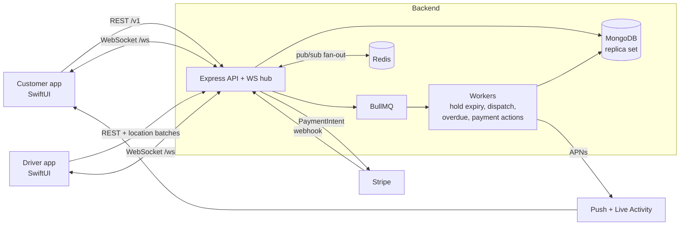

# Architecture



## Principles
- **Server is the source of truth.** WebSocket and APNs are hints; clients resync over REST on reconnect or a version/seq gap.
- **Correctness lives in the database:** conditional updates and transactions, never read-then-write in application code.
- **Retries are safe:** mutating endpoints take an `Idempotency-Key`; every state change is idempotent on its key; webhooks dedupe on event id.
- **Side effects after commit:** realtime events, pushes and job scheduling run only once the transaction has committed.

## Order lifecycle (two legs)
```
PENDING_PAYMENT -> CONFIRMED -> OUT_FOR_DELIVERY -> DELIVERED -> IN_USE -> RETURN_SCHEDULED
                                                                   |            ^
                                                                   v            |
                                                                 OVERDUE -------+
RETURN_SCHEDULED -> PICKED_UP -> INSPECTED -> SETTLED
PENDING_PAYMENT -> PAYMENT_FAILED          (CONFIRMED | PENDING_PAYMENT) -> CANCELLED
```
The table lives in `backend/src/modules/orders/orderStateMachine.ts` as data, and is unit-tested for reachability and terminal states.

## Money
One authorization (manual capture) for rent + deposit. At settlement we capture rent + late fee + damage, capped at the authorized amount; the rest of the hold is released. Cancellation releases the whole hold.

## Real-time
- Frames: `order.updated {status, version}`, `driver.location {seq, etaMinutes}`, `task.offer`, `order.driver_assigned`.
- Rooms: `user:<id>` (implicit), `order:<id>` (authorized per subscription: customer, shop, or assigned driver).
- Multi-instance: each instance publishes to a Redis channel and delivers to its own sockets.

## Known limits
- Rate limiting is per instance (in-memory store).
- Availability is UTC-day granular; early returns do not free the remaining days.
- Card authorizations expire (about 7 days); long rentals need re-authorization.
- Driver dispatch scans open tasks to find busy drivers; at larger scale keep a `busy` flag on the driver.
- Post-commit side effects are not transactional with the commit (no outbox). A crash in between loses a push or job; clients still converge via REST, and the hold-expiry and payment jobs are idempotent.
- Straight-line ETA, no routing engine.
