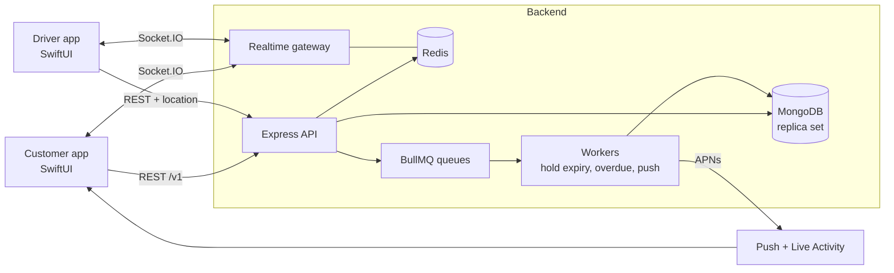

# Architecture

## Principles
- **Server is the source of truth.** WebSocket and APNs are hints; clients resync over REST on reconnect or version gap.
- **Correctness lives in the database:** conditional updates and transactions, not application locks.
- **Retries are safe:** mutating endpoints take an `Idempotency-Key`.
- **Side effects after commit:** emit events and enqueue jobs only once the transaction has committed.

## Order lifecycle (two legs)
`PENDING_PAYMENT → CONFIRMED → OUT_FOR_DELIVERY → DELIVERED → IN_USE → RETURN_SCHEDULED → PICKED_UP → INSPECTED → SETTLED`
Side branches: `PAYMENT_FAILED`, `CANCELLED`, `OVERDUE`.

## Known limits (fill in as you go)
- Rate limiting is per instance (in-memory store).
- Availability is day-granular.
